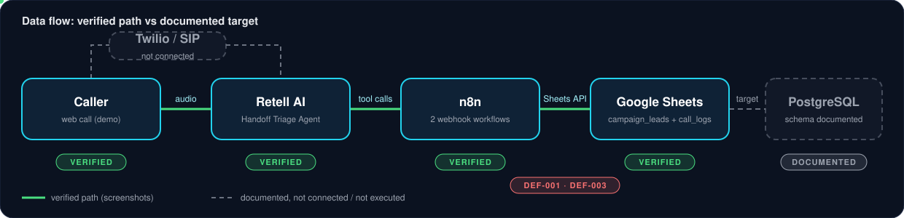
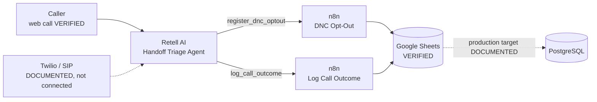
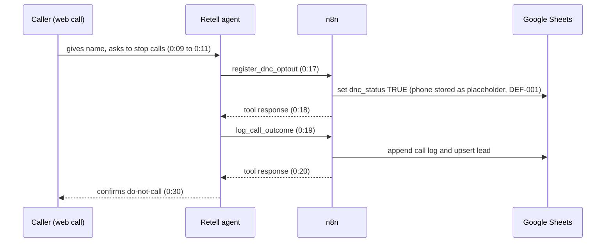

<div align="center">



<br>

<a href="https://www.loom.com/share/336f6e1893c34d129c5b84d8d58b4e7d"></a>
&nbsp;
<a href="docs/"></a>
&nbsp;
<a href="docs/known-defects-and-fixes.md"></a>
&nbsp;
<a href="assessment/evidence-and-limitations.md"></a>

<br><br>


<br>

**A client delivery, documentation and maintenance handoff for a Retell AI inbound voice agent.**<br>
Triage agent &rarr; n8n webhooks &rarr; Google Sheets, with the PostgreSQL production schema documented.


</div>

> [!IMPORTANT]
> **Evidence over claims.** Every statement about the system in this repository is tagged **VERIFIED** (seen in screenshots), **DOCUMENTED** (stated only in the supplied course documents), **PENDING** (not done yet) or **DEFECT** (confirmed problem). Read [Limitations and known defects](#limitations-and-known-defects) before relying on anything here.

<div align="center">

</div>

<details>
<summary><b>Table of contents</b> (click to expand)</summary>

1. [What this project is](#what-this-project-is)
2. [Architecture](#architecture)
3. [Verified implementation evidence](#verified-implementation-evidence)
4. [Status at a glance](#status-at-a-glance)
5. [Repository navigation](#repository-navigation)
6. [Setup](#setup)
7. [Database schema](#database-schema)
8. [Testing and verification](#testing-and-verification)
9. [Security notes](#security-notes)
10. [Limitations and known defects](#limitations-and-known-defects)
11. [Assessment deliverables](#assessment-deliverables)
12. [Future improvements](#future-improvements)

</details>

## What this project is

The **Handoff Triage Agent** is a Retell AI inbound voice agent for a retail support line. It greets the caller, asks for a first name and the issue, and sorts the call into **order status**, **tech support** or **do-not-call opt-out**. It uses two custom tools that call n8n webhooks:

| Tool | Purpose | n8n workflow |
|---|---|---|
| `register_dnc_optout` | Marks the caller's number as do-not-call | DNC Opt-Out |
| `log_call_outcome` | Logs the call outcome and upserts the lead | Log Call Outcome |

The deliverable is the **handoff package** around it: topology, schema, prompt version history, escalation matrix, launch checklist, maintenance runbook, test cases and honest evidence, so a client team can operate the agent without the original builder (Topic 14: *Client Delivery, Documentation and Maintenance Handoff*).

## Architecture

<div align="center">

</div>



More detail: [`docs/architecture.md`](docs/architecture.md) and [`docs/integration-topology.md`](docs/integration-topology.md).

## Verified implementation evidence

Everything below comes from screenshots of the live Retell, n8n and Google Sheets UIs (2026-10-20).

| Area | What was seen |
|---|---|
| **Retell** | Handoff Triage Agent, web call, 54 s, *Call Successful*. Transcript shows `register_dnc_optout` and `log_call_outcome` calls with responses, then the agent confirming the do-not-call addition. The call ran on Retell **version 2**. |
| **n8n** | "Log Call Outcome" execution *Succeeded*: Webhook, Append Call Log and Upsert Lead nodes all green. A Set DNC node returned `dnc_status = TRUE`. |
| **Google Sheets** | "Handoff Triage Demo_1" with tabs `campaign_leads` and `campaign_call_logs`. A call log with `outcome_label = dnc_optout` and a lead with `dnc_status = TRUE` were written. |

<details>
<summary><b>Sequence of the verified web call</b> (click to expand)</summary>



</details>

Full evidence list with what each screenshot proves: [`assessment/evidence-and-limitations.md`](assessment/evidence-and-limitations.md). The recorded demo: [Loom video](https://www.loom.com/share/336f6e1893c34d129c5b84d8d58b4e7d).

## Status at a glance

<div align="center">


</div>

## Repository navigation

```text
retell-ai-client-handoff-package/
├── README.md
├── assets/                  animated banner, flow diagram, buttons (SVG)
├── docs/
│   ├── architecture.md
│   ├── integration-topology.md
│   ├── client-handoff.md
│   ├── prompt-change-log.md
│   ├── escalation-matrix.md
│   ├── launch-checklist.md
│   ├── maintenance-runbook.md
│   ├── documentation-standards.md
│   ├── requirements-mapping.md
│   ├── user-stories-risks-dependencies.md
│   └── known-defects-and-fixes.md
├── database/                schema.sql, README.md
├── config/                  .env.example (placeholders only)
├── agent-export/            instructions for the Retell export
├── n8n-workflows/           instructions for the workflow exports
├── assessment/              FAQ, exercises, test cases, evidence and limitations
├── demo/                    video script
└── evidence/                guidance for redacted screenshots
```

| Document | What it covers |
|---|---|
| 🏗️ [`docs/architecture.md`](docs/architecture.md) | Components and deviations from the supplied topology |
| 🔌 [`docs/integration-topology.md`](docs/integration-topology.md) | Data path, endpoints, tool payload, field mapping |
| 🤝 [`docs/client-handoff.md`](docs/client-handoff.md) | What the client receives, ownership, adoption steps |
| 🧾 [`docs/prompt-change-log.md`](docs/prompt-change-log.md) | Version history with evidence status |
| 🚨 [`docs/escalation-matrix.md`](docs/escalation-matrix.md) | Incidents, owners, SLAs |
| ✅ [`docs/launch-checklist.md`](docs/launch-checklist.md) | Pre-launch checks with honest statuses |
| 🛠️ [`docs/maintenance-runbook.md`](docs/maintenance-runbook.md) | Monitoring, troubleshooting, release, rollback, sign-off |
| 📐 [`docs/documentation-standards.md`](docs/documentation-standards.md) | Annotation and evidence standards |
| 🔗 [`docs/requirements-mapping.md`](docs/requirements-mapping.md) | BRD / PRD / FR / US / TC traceability |
| ⚠️ [`docs/known-defects-and-fixes.md`](docs/known-defects-and-fixes.md) | Defects, proposed fixes, required retests |
| 🧪 [`assessment/test-cases.md`](assessment/test-cases.md) | Test matrix with PASS / FAIL / PENDING |
| ❓ [`assessment/faq-answers.md`](assessment/faq-answers.md) | Answers to all 15 FAQ questions |
| 📝 [`assessment/exercise-answers.md`](assessment/exercise-answers.md) | Exercises 1 to 12 |

## Setup

<details open>
<summary><b>Quick start (5 steps)</b></summary>

1. **Retell:** import or recreate the agent and set the two tool URLs to your own n8n webhooks. The export is a manual step: [`agent-export/README.md`](agent-export/README.md).
2. **n8n:** import the workflows ([`n8n-workflows/README.md`](n8n-workflows/README.md)), attach your own Google Sheets OAuth2 credential, point the nodes at a **native Google Sheet** (an uploaded `.xlsx` fails with "The document must not be an Office file"), then publish.
3. **Data:** create the tabs or tables described in [`database/README.md`](database/README.md) and format the phone column as plain text in Sheets.
4. **Config:** copy `config/.env.example` to `.env`, fill in your own values and keep it out of Git.
5. **Verify:** work through [`docs/launch-checklist.md`](docs/launch-checklist.md).

</details>

<details>
<summary><b>Environment variables (placeholders only)</b></summary>

| Variable | Purpose |
|---|---|
| `RETELL_API_KEY`, `RETELL_AGENT_ID` | Retell access and agent reference |
| `N8N_BASE_URL`, `N8N_WEBHOOK_LOG_CALL_PATH`, `N8N_WEBHOOK_DNC_PATH` | Your n8n instance and webhook paths |
| `GOOGLE_SHEET_ID` | Demo data store |
| `DATABASE_URL` | Production PostgreSQL (placeholder) |
| `SIP_TRUNK_GATEWAY`, `SYSTEM_OUTBOUND_NUMBER` | Client-provided telephony |

See [`config/.env.example`](config/.env.example). All values are placeholders.

</details>

<details>
<summary><b>Workflow import and export</b></summary>

Export from n8n with the workflow menu `...` &rarr; **Download**; export the Retell agent from **Agents** &rarr; **Export**. Review each JSON for keys and private URLs before committing. Step-by-step: [`n8n-workflows/README.md`](n8n-workflows/README.md) and [`agent-export/README.md`](agent-export/README.md).

</details>

## Database schema

Two tables: `campaign_leads` and `campaign_call_logs` (one lead has many call logs through `lead_id`).

```bash
psql "$DATABASE_URL" -f database/schema.sql
```

The DDL is **DOCUMENTED** and has not been executed in this project; the demonstrated store is Google Sheets with the same column names. Field notes and the Sheets-versus-PostgreSQL differences: [`database/README.md`](database/README.md).

## Testing and verification

Snapshot of the 9 project tests defined in [`assessment/test-cases.md`](assessment/test-cases.md):

| Result | Count | Tests |
|---|---|---|
| PASS | 2 | T-01 opt-out handling (single call), T-08 credential scan (generated files) |
| PARTIAL | 2 | T-02 DNC persistence, T-03 call outcome logging |
| FAIL | 1 | T-04 correct phone-number matching |
| PENDING | 4 | T-05 webhook failure, T-06 duplicates, T-07 missing fields, T-09 pre-launch validation |

The five source test cases (TC-001 to TC-005) are all pending or partial. Nothing unexecuted is marked as passed.

## Security notes

- No API keys, tokens, private webhook URLs or spreadsheet IDs are committed. Treat production webhook URLs as secrets.
- The workflows do not yet verify the `x-retell-signature` header that Retell sends (proposed in [`docs/known-defects-and-fixes.md`](docs/known-defects-and-fixes.md)).
- Screenshots show address bars and account details; redact them before publishing ([`evidence/README.md`](evidence/README.md)).

## Limitations and known defects

> [!WARNING]
> **DEF-001:** the live web call stored the literal text `{{user_number}}` as the phone number (web calls have no caller number). A do-not-call record stored against a placeholder will not match the caller's real number later. A fix is proposed in [`docs/known-defects-and-fixes.md`](docs/known-defects-and-fixes.md); it is **not implemented or retested**.

| ID | Issue | Status |
|---|---|---|
| DEF-001 | Phone number stored as `{{user_number}}`, breaking DNC matching | Open, retest required |
| DEF-002 | `+` dropped from phone numbers in Google Sheets | Open |
| DEF-003 | `call_duration_seconds` empty in the live call row | Open |
| DEF-004 | `lead_id` and `call_log_id` blank in the Sheets demo | Open |
| n/a | No Twilio/SIP number; 15-scenario QA pack not run; v1.2.0 not verified live; agent and workflow exports not included; PostgreSQL DDL not executed; 2-hour deploy test not run | Pending |

## Assessment deliverables

| Deliverable | Status |
|---|---|
| Loom demo video | Recorded, see the button above |
| Public GitHub repository | This repository |
| Completed handoff package | Drafted, with the gaps listed above |
| Assessment responses | [`assessment/`](assessment/) |
| Supporting documentation | [`docs/`](docs/) |

## Future improvements

Fix DEF-001 to DEF-004 and retest; verify webhook signatures; make call logging idempotent; run the 15-scenario QA pack; bind a real phone number and test a real call; move to PostgreSQL; add an SLA dashboard and alerting.

<div align="center">


<sub>Built for the Retell AI Topic 14 assessment &middot; MIT licensed &middot; Evidence over claims</sub>

</div>
