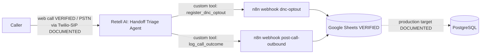

# Architecture

Evidence tags used across this repository: **VERIFIED** (seen in screenshots), **DOCUMENTED** (stated in the supplied Topic 14 documents only), **PENDING** (not yet done), **DEFECT** (confirmed problem).

## System overview

## Components
| Component | Detail | Status |
|---|---|---|
| Voice agent | Retell "Handoff Triage Agent" (inbound triage: order status, tech support, opt-out) | VERIFIED |
| Tools | `register_dnc_optout`, `log_call_outcome` (called in the transcript), `end_call` (configured, not seen in the transcript) | VERIFIED / configured |
| LLM | `gpt-4.1` (the source documents name GPT-4o, which was not in this Retell account's model list) | Configured, per project notes |
| Orchestration | n8n Cloud: workflows "Log Call Outcome" and "DNC Opt-Out" | VERIFIED |
| Data store (demo) | Google Sheet "Handoff Triage Demo_1": `campaign_leads`, `campaign_call_logs` | VERIFIED |
| Data store (production) | PostgreSQL with DDL in `database/schema.sql` | DOCUMENTED, not executed |
| Telephony (production) | Twilio / SIP trunk | DOCUMENTED, not connected |

## Deviations from the supplied documentation
1. The supplied topology is *Caller -> Twilio -> Retell -> n8n -> PostgreSQL*. The demonstration used a Retell **web call** and **Google Sheets**.
2. The documented path `post-call-outbound` is used as the shared call-logging endpoint although this agent is inbound. The agent calls it during the call via the `log_call_outcome` tool, not after the call ends.
3. Both webhooks reply `{"status":"ok"}` immediately, so downstream write failures are invisible to the agent.

See `docs/integration-topology.md` for the data path in detail and `docs/known-defects-and-fixes.md` for defects.
